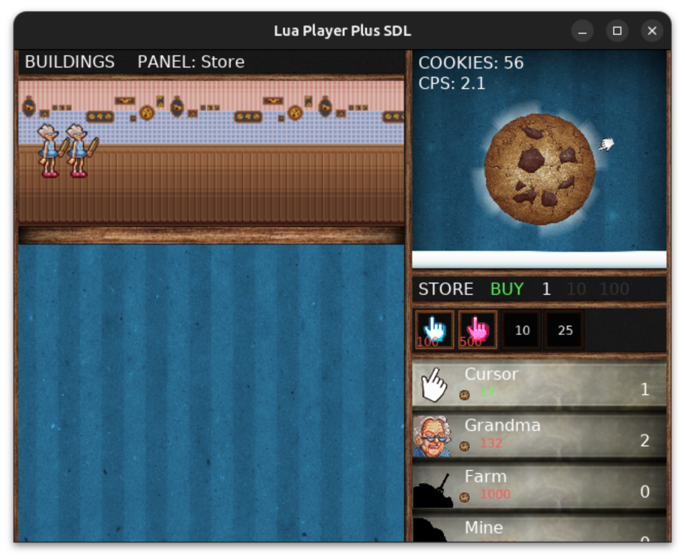

# CookieClicker SDL
It's Cookie Clicker clone made in LUA using Lua Player Plus SDL based off CookieClicker Vita by  Creckeryop 

## Features
* Buildings until Prism
* Two panel layout to work on smaller screen resolutions
* Buy and Sell Buildings, (1/10/100)pcs
* Save Loading(save file is in the root of folder called ccsave.sav, ccupsave.sav)
* Buildings view follows the store selection
* Toggle buy/sell modes
* Press X (keyboard) or B (controller) to click the cookie
* And also UPGRADES
* Sound effects for clicking, buying, selling and upgrades (generated by `tools/make_sfx.py`)
## Controls

| Action | Gamepad | Keyboard |
| -- | -- | -- |
| Click the cookie | B | X |
| Move in the store | D-pad / left stick up/down | Up/Down |
| Buy amount (1/10/100) | D-pad left/right | Left/Right |
| Buy or sell (hold to repeat) | A | Enter |
| Buy the next upgrade for the selected building | Y | Y |
| Toggle buy/sell | L or R | T |
| Menu (saves) | Start | Backspace |
| Back (menus) | B | Backspace |
| Quit | | Esc |

## Credits
* [Rinnegatamante](https://github.com/Rinnegatamante/) - [lpp-vita](https://github.com/Rinnegatamante/lpp-vita)
* [Creckeryop](https://github.com/Creckeryop) - [CookieClicker Vita](https://github.com/Creckeryop/CookieClicker-Vita)